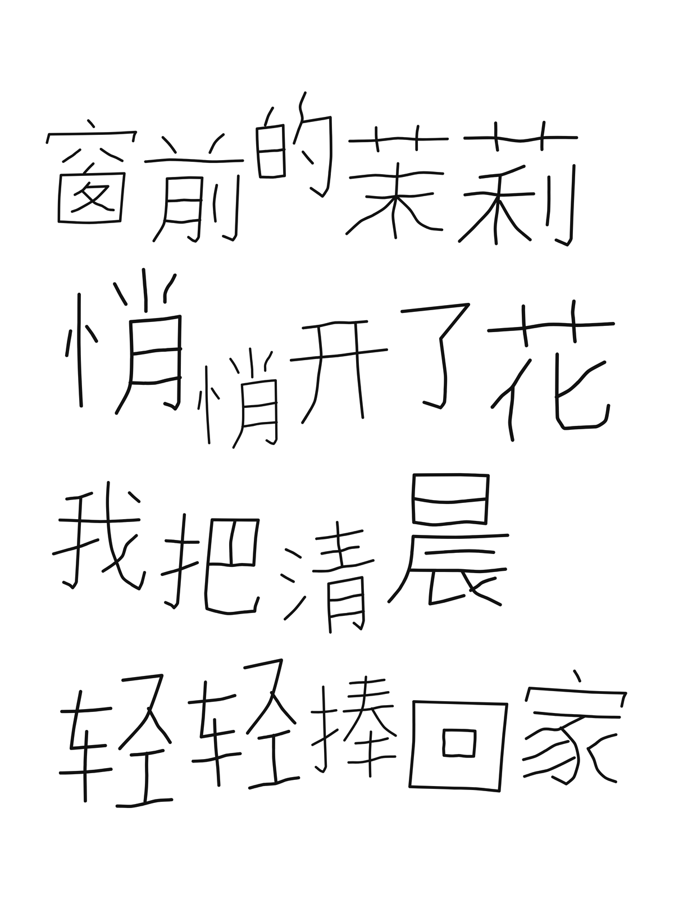
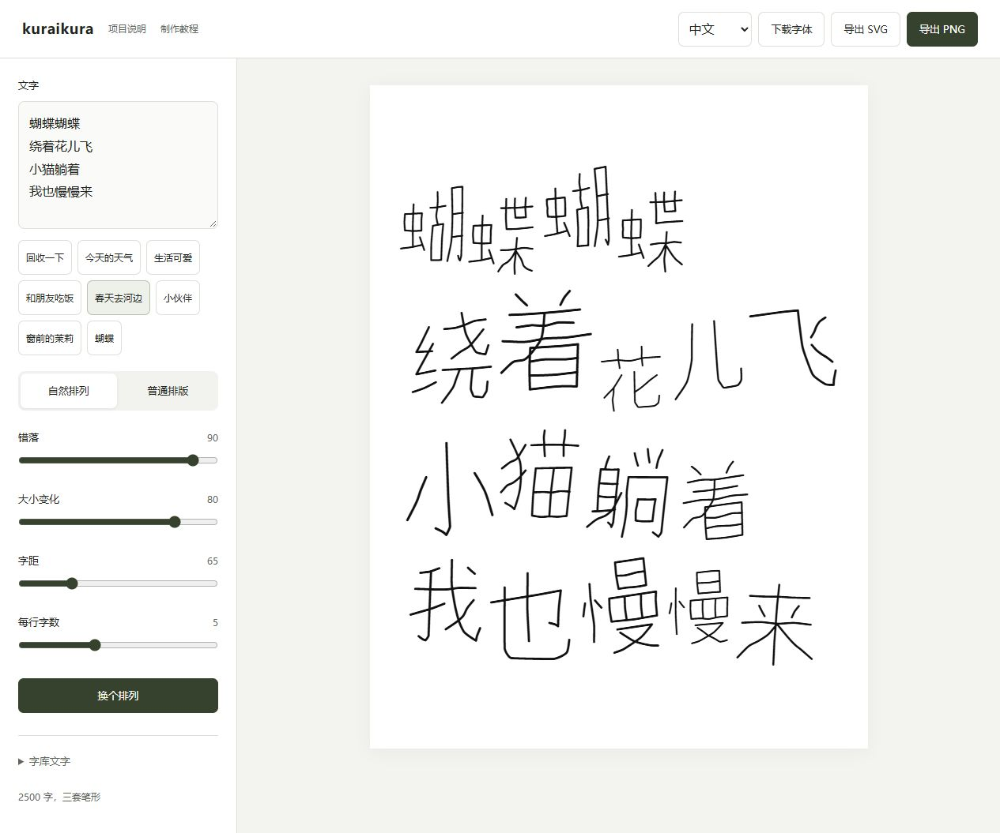
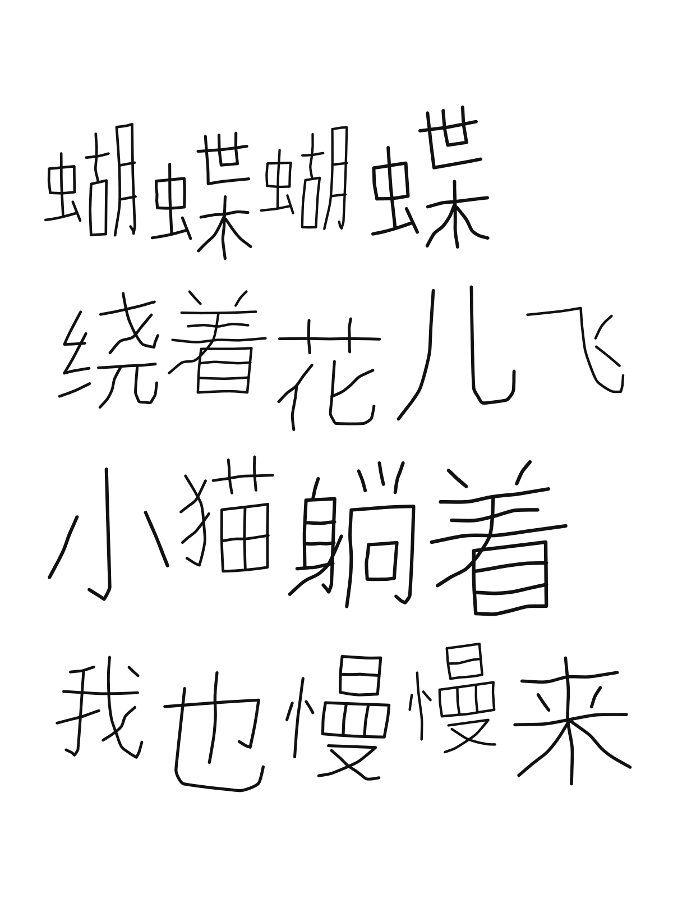

# kuraikura

[中文](README.md) / English / [日本語](README.ja.md)

A Chinese handwriting font developed from 15 handwritten samples. Thin rounded strokes, extended verticals and varied component proportions pair with compact, uneven layouts.

[Download font](https://github.com/daafffodil/kuraikura/releases/latest/download/kuraikura-fonts.zip) | [Try the layout tool](https://daafffodil.github.io/kuraikura/?lang=en) | [Offline tool](https://github.com/daafffodil/kuraikura/releases/latest/download/kuraikura-layout.zip) | [How it was made](https://github.com/daafffodil/handwriting-to-font/blob/main/README.en.md)

## Coverage

Version 0.7.0 contains **3,000 Hanzi, with three forms per character**, plus Latin letters, digits and common punctuation. [Full character list](CHARACTERS.txt)

The goal is approximately 7,000 Hanzi through reviewed updates. The current set is incomplete and contains no kana. A Japanese translation of the interface does not mean full Japanese coverage or region-specific Japanese glyph forms.

## Installation

Download `kuraikura-fonts.zip`, extract it and install `kuraikura-Regular.ttf`. Windows and macOS use the same file.

- Windows: right-click the TTF and install it. Reopen your application and choose kuraikura.
- macOS: open the TTF in Font Book and install it, then reopen your application.
- Phones and tablets: import the TTF into an application that supports custom fonts. This does not replace every system font.
- Websites: use the WOFF2 and CSS example in the font package.

Download the named font package from Releases, rather than GitHub's automatically generated source archive. Desktop browser layout and export have been checked; macOS, iOS and Android have not been tested on individual devices.

## Layout

Open the online tool, or extract the offline package and open `kuraikura-layout.html` in a browser. Enter text, choose Natural, adjust spacing, size and scatter, then export SVG or PNG. The language selector changes the interface, not your text.

The tool includes its matching font and glyph data. **No font installation or TTF import is needed.** Text is processed locally in your browser and is not sent to a server or AI service. The online tool downloads resources when opened; the offline tool requires no connection.

Repeated characters cycle through three forms, avoiding the same form on consecutive occurrences. The selected forms and positions are preserved in the export.

Other applications use the default form, or `ss01` and `ss02` where stylistic sets are supported. Automatic repetition handling and scattered placement belong to the companion tool; installing the font does not enable them everywhere.

SVG exports contain outlined glyphs grouped by character. They remain editable as vector shapes without an installed font, but are no longer editable text and do not necessarily contain separate stroke objects. PNG exports are transparent, 2400 × 3200 pixels.

## Help

- Missing glyphs: check the character list. The layout tool reports unsupported characters instead of silently replacing them.
- HTML appears as code: download it and open the file with a browser.
- Updating: update both the installed font and the offline tool; they do not update each other.
- Stroke editing: use the [editor and workflow guide](https://github.com/daafffodil/handwriting-to-font/blob/main/README.en.md). Centerline SVG strokes support length, bend and thickness editing. Expanded outlines support shape transforms and layout.

## Authorship and license

Original handwriting and art direction: [daafffodil](https://github.com/daafffodil). The author confirmed authorship of the initial 15 samples: 旧 衣 回 收 一 下 总 有 惊 喜 秋 日 的 时 刻. AI assisted vector drawing, component-based expansion, compilation and review.

The font is released under the **Arphic Public License**, allowing free personal and commercial use without a separate permission request. Modification and redistribution must follow the full license, retain notices and document changes. The handwriting attribution has been corrected; historical vector-processing license records are retained. See [LICENSE.txt](LICENSE.txt) and [SOURCES.txt](SOURCES.txt).

Independently authored tools and documentation use [MIT](licenses/MIT.txt). This does not relicense the font assets. The download does not contain the full stroke-authoring database; the font and shipped glyph data remain modifiable under their applicable license.

## Development

Planned milestones are 3,500, 5,000 and approximately 7,000 Hanzi, with review at every stage. [Changelog](CHANGELOG.md)

Report missing characters or rendering issues in [Issues](https://github.com/daafffodil/kuraikura/issues), including the text, version, application and a screenshot. Maintainer: [daafffodil](https://github.com/daafffodil).
