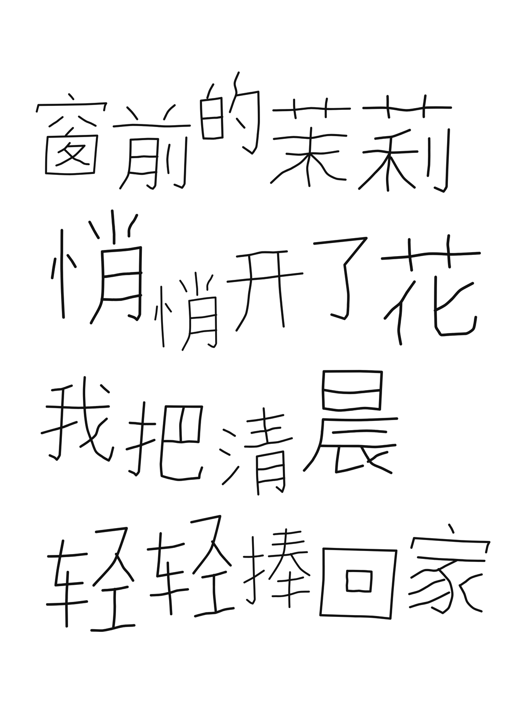
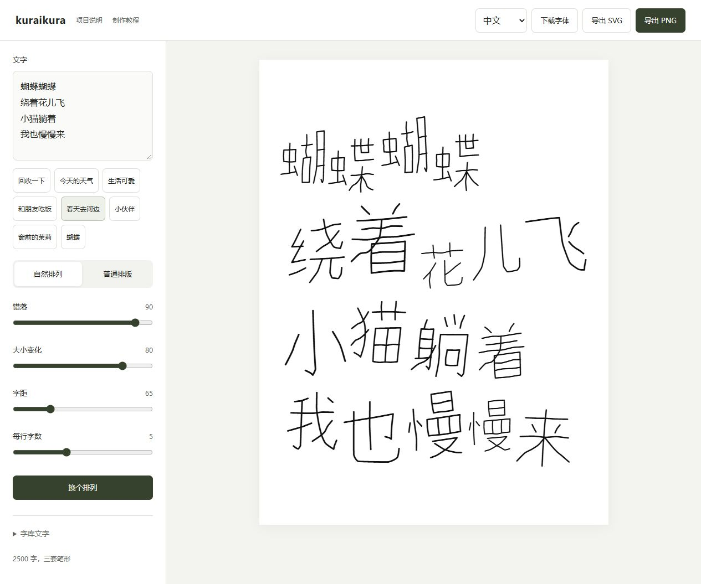
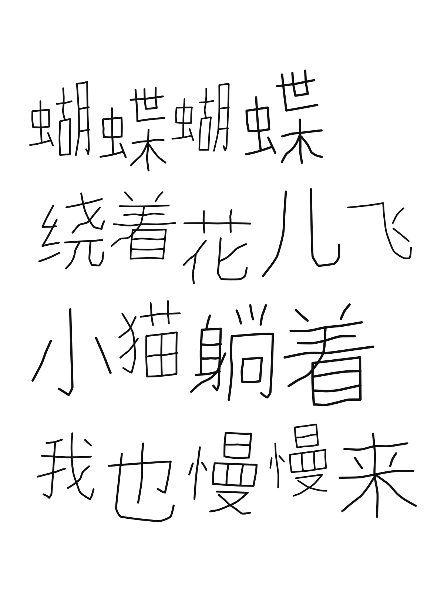

# kuraikura

[中文](README.md) / [English](README.en.md) / 日本語

15 字の手書き見本から制作した中国語の手書きフォントです。細く丸い線、伸びやかな縦画、部品の大きさの違いを生かし、字間を詰めた自然な配置ができます。

[フォントをダウンロード](https://github.com/daafffodil/kuraikura/releases/latest/download/kuraikura-fonts.zip) | [オンラインで配置](https://daafffodil.github.io/kuraikura/?lang=ja) | [オフライン版](https://github.com/daafffodil/kuraikura/releases/latest/download/kuraikura-layout.zip) | [制作方法](https://github.com/daafffodil/handwriting-to-font/blob/main/README.ja.md)

## 収録文字

0.6.0 には **漢字 2500 字、各字 3 種類の字形**に加え、英字、数字、主な句読点を収録しています。[収録文字一覧](CHARACTERS.txt)

中国語の漢字を中心に、約 7000 字を目指して段階的に拡充します。**ひらがなとカタカナは未収録です。**日本語の説明や操作画面は、日本語全体への対応を意味しません。日本語で使う場合は、必要な漢字の収録と字形の適合を確認してください。

## インストール

`kuraikura-fonts.zip` を展開し、`kuraikura-Regular.ttf` をインストールします。Windows と macOS は同じファイルを使います。

- Windows：TTF を右クリックしてインストールし、アプリを開き直して kuraikura を選びます。
- macOS：TTF をダブルクリックし、Font Book でインストールします。
- スマートフォンやタブレット：カスタムフォントに対応したアプリへ TTF を読み込みます。すべてのシステム表示が変わるわけではありません。
- Web サイト：フォントパッケージの WOFF2 と CSS サンプルを使います。

GitHub が自動作成する開発用アーカイブではなく、Releases のフォント ZIP を選んでください。デスクトップのブラウザーで配置と書き出しを確認済みですが、macOS、iOS、Android の各実機では未検証です。

## 自然な配置

オンライン版を開くか、オフライン版を展開して `kuraikura-layout.html` をブラウザーで開きます。文字を入力し、自然な配置を選んで字間、サイズ、位置の変化を調整した後、SVG または PNG を保存します。言語選択は操作画面だけを切り替え、入力文は翻訳しません。

ツールには対応するフォントと字形データが含まれています。**フォントの事前インストールや TTF の読み込みは不要です。**入力文はブラウザー内で処理し、サーバーや AI に送信しません。オンライン版は最初にデータを取得し、オフライン版は通信せずに使えます。

同じ文字が繰り返されると 3 種類の字形を順に使い分け、連続して同じ形にならないようにします。選ばれた字形と配置は保存結果にも残ります。

ほかのアプリでは基本字形を使用し、対応アプリでは `ss01`、`ss02` の字形も選べます。位置の変化や繰り返し文字の自動切り替えは、この配置ツールの機能です。

SVG は文字ごとにまとめたアウトラインで、フォントをインストールしていない相手も表示や図形編集ができます。ただし普通のテキストではなく、各筆画が必ず独立しているわけでもありません。PNG は背景透過の 2400 × 3200 ピクセルです。

## 困ったとき

- 未収録文字：文字一覧を確認してください。配置ツールは不足する文字を表示します。
- HTML がコードとして表示される：ダウンロードしてからブラウザーで開いてください。
- 更新：フォントとオフラインツールを両方更新してください。
- 筆画の調整：[制作方法と編集ツール](https://github.com/daafffodil/handwriting-to-font/blob/main/README.ja.md)を参照してください。中心線のある SVG は長さ、曲がり、太さを調整でき、展開済みの輪郭は図形の変形や配置に使えます。

## 作者とライセンス

手書き原稿と制作方針は [daafffodil](https://github.com/daafffodil) によるものです。最初の 15 字「旧 衣 回 收 一 下 总 有 惊 喜 秋 日 的 时 刻」は本人が手書きしたことを確認しています。SVG の描画、部品を使った拡張、コンパイル、確認には AI の支援を利用しました。

フォントは **Arphic Public License** で公開し、個人利用も商用利用も無料で、個別の許可申請は不要です。改変や再配布では、ライセンス全文、表示の保持、変更記録などの条件に従ってください。原稿作者の情報を修正し、既存のベクター処理に関するライセンス記録は保持しています。[LICENSE.txt](LICENSE.txt)、[SOURCES.txt](SOURCES.txt)

独自に作成したツールコードと文書は [MIT](licenses/MIT.txt) です。このライセンスはフォント素材のライセンスを置き換えません。全字の筆画編集用データは配布パッケージに含めていませんが、配布するフォントと字形データは各ライセンスに従って改変できます。

## 更新と連絡

3500 字、5000 字、約 7000 字を目標に、字形を確認しながら拡充します。[更新記録](CHANGELOG.md)

不足文字や表示の問題は、文字、バージョン、アプリ名、画像を添えて [Issues](https://github.com/daafffodil/kuraikura/issues) へお知らせください。管理者：[daafffodil](https://github.com/daafffodil)。
