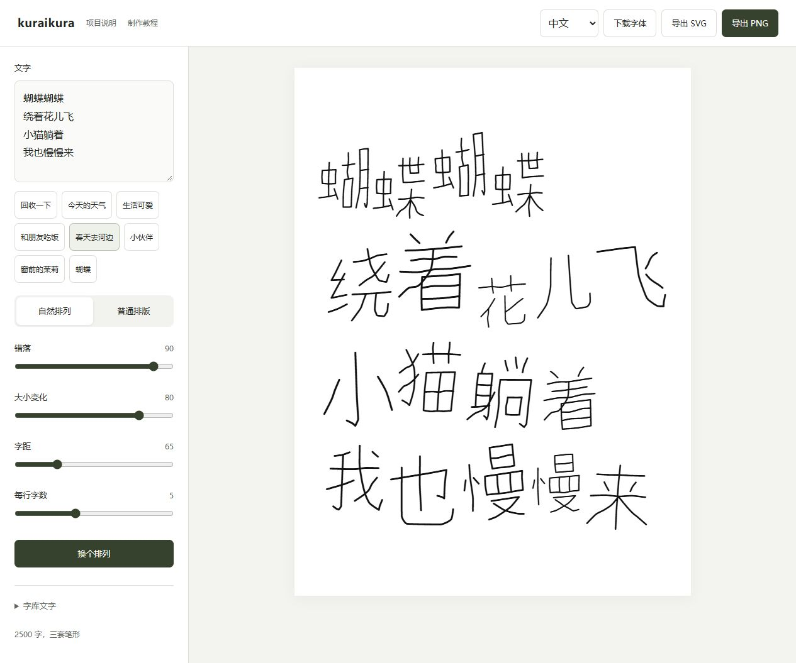
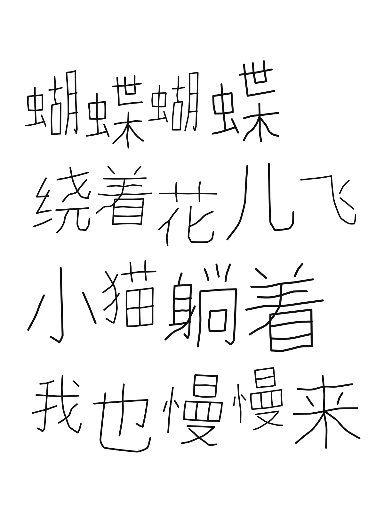

# kuraikura

中文 / [English](README.en.md) / [日本語](README.ja.md)

从 15 个手写样字开始的一套中文手写字体。细圆线、舒展的长笔和不同的部件比例，配合紧凑、错落的排版。

[下载字体](https://github.com/daafffodil/kuraikura/releases/latest/download/kuraikura-fonts.zip)　[在线排版](https://daafffodil.github.io/kuraikura/)　[离线排版](https://github.com/daafffodil/kuraikura/releases/latest/download/kuraikura-layout.zip)　[制作过程与工具](https://github.com/daafffodil/handwriting-to-font)

## 当前版本

0.7.0，收录 **3000 个汉字，每字三套笔形**，另含英文大小写、数字及常用标点。[查看完整字表](CHARACTERS.txt)

字库仍在扩充，计划逐步达到约 7000 个汉字。当前字表不是全部常用汉字，也没有收录假名。日文介绍与日文界面不代表完整日文覆盖，使用日文时请先检查所需汉字是否收录及字形是否适用。

## 下载与安装

下载上方字体 ZIP 并解压，安装其中的 `kuraikura-Regular.ttf`。

| 环境 | 使用方法 |
| --- | --- |
| Windows | 右键 TTF，选择安装，重新打开软件，在字体列表选择 kuraikura |
| macOS | 双击同一个 TTF，在字体册中安装，再打开使用字体的软件 |
| 手机和平板 | 在支持导入字体的应用中导入 TTF；能否使用取决于应用，不会自动替换系统字体 |
| 网页 | 使用包中的 WOFF2 和 CSS 示例 |

一般用户下载 `kuraikura-fonts.zip` 即可，不需要下载 GitHub 自动生成的开发资料压缩包。字体包保留完整三套笔形。Mac 和 Windows 不需要不同的字体文件。

当前桌面浏览器排版和导出已验证。macOS、iOS、Android 尚未逐设备验证，欢迎报告具体软件中的问题。

## 自然排版

1. 打开在线排版，或解压离线包，用浏览器打开 `kuraikura-layout.html`。
2. 输入文字，按需要换行，选择自然排列。
3. 调整错落、大小变化、字距和每行字数，点击换个排列查看另一种组合。
4. 导出 SVG 或透明背景 PNG。

工具自带对应版本的字库，**无需先安装字体或再导入 TTF**。输入内容在浏览器本地处理，不发送给服务器或 AI；在线版首次打开需要下载字形资源，离线版无需联网。

同一段文字中重复的字会轮换三套笔形；用完再轮换，连续出现时避免使用相同的一套。变化保留在导出结果中。

安装字体后，其他软件可以使用默认笔形；支持 OpenType 样式集的软件还可选择 `ss01`、`ss02`。**随机错落和重复字轮换由排版工具完成，不会在所有软件中自动出现。**

SVG 保存的是按字分组的矢量轮廓，不依赖接收者安装字体，可继续编辑节点与排列；它不是可直接换字的普通文本，也不保证每笔都是独立对象。PNG 导出为 2400 × 3200 像素，透明背景。

## 常见问题

- 出现不一样的字体或方框：可能缺字，请检查字表。排版工具会直接提示缺字。
- 打开 HTML 看到源码：先下载，再通过浏览器打开文件。
- 安装新版后离线页没变：字体和离线工具独立保存，请一起更新。
- 需要逐笔调整：查看[字形编辑器与制作教程](https://github.com/daafffodil/handwriting-to-font)。逐笔 SVG 可以改长度、弯曲和粗细；已展开的填充轮廓适合整字变换与排列。

## 来源与许可

手写原稿与风格方向由 [daafffodil](https://github.com/daafffodil) 提供。作者确认最初 15 个样字由本人手写：旧、衣、回、收、一、下、总、有、惊、喜、秋、日、的、时、刻。后续使用 AI 辅助逐笔矢量设计、部件扩展、字体编译和校对。

本版字体按 **Arphic Public License** 发行，可免费用于个人和商业项目，无需另行联系申请。再分发或修改字体时，须遵守完整许可，保留相关声明和修改记录。原稿作者信息已补充更正，既有矢量工程的许可记录继续保留。详情见 [LICENSE.txt](LICENSE.txt) 和 [SOURCES.txt](SOURCES.txt)。

独立编写的工具代码与文档采用 [MIT](licenses/MIT.txt)。代码许可不替代字体许可。完整逐笔设计工程未放入本下载包，字体文件及工具字形数据仍可按相应许可修改。

## 更新与反馈

计划分批扩充到 3500、5000、约 7000 字，每批继续检查字形、识别和重复字效果。[更新记录](CHANGELOG.md)

请在 [Issues](https://github.com/daafffodil/kuraikura/issues) 报告缺字或显示问题，附上具体文字、字体版本、软件和截图。项目维护与联系：[daafffodil](https://github.com/daafffodil)。
